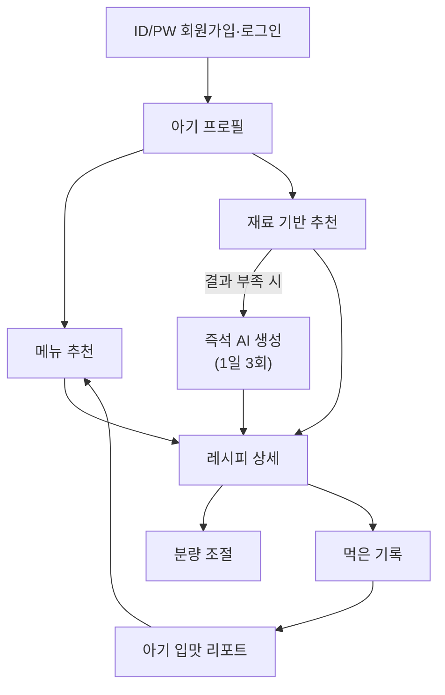
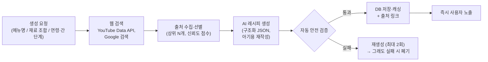
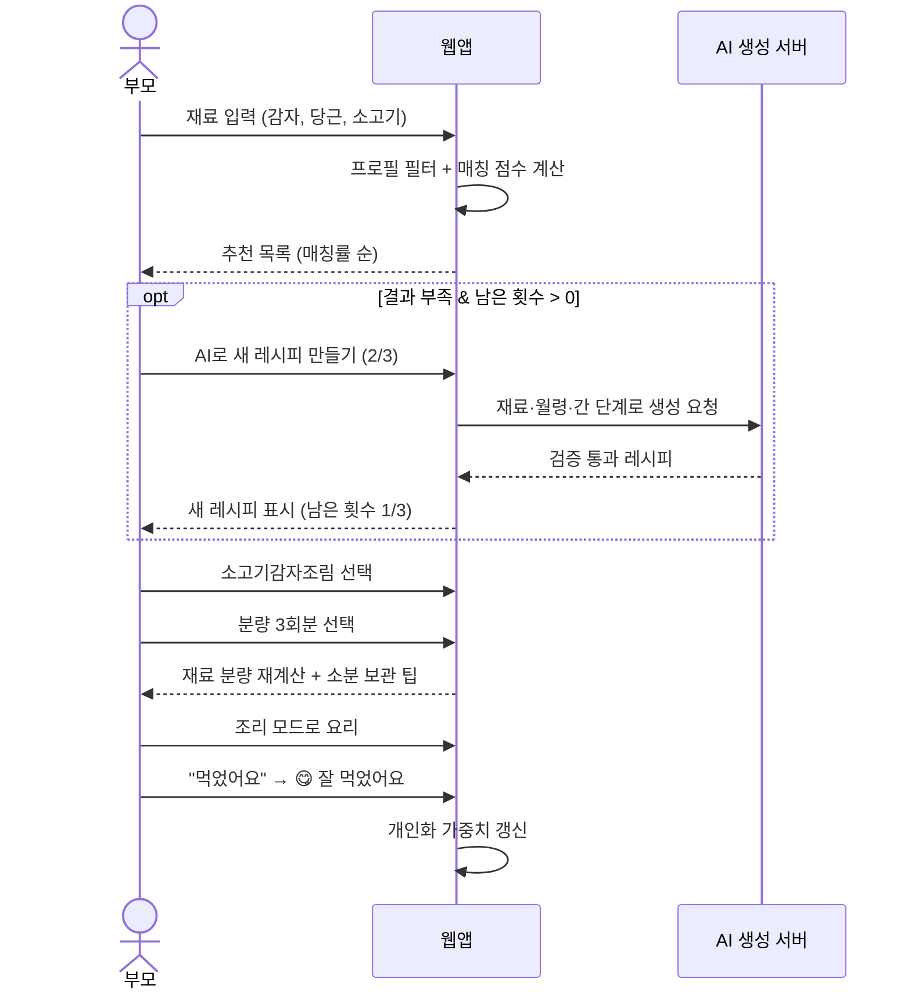
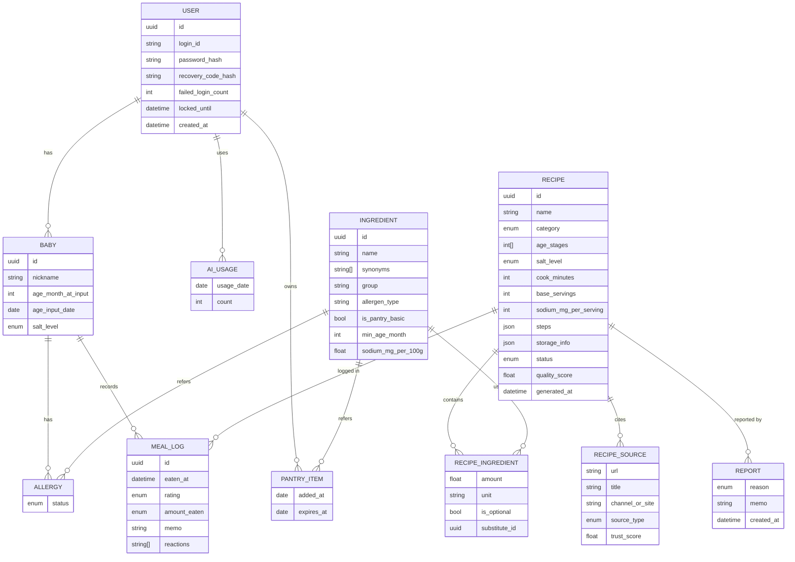
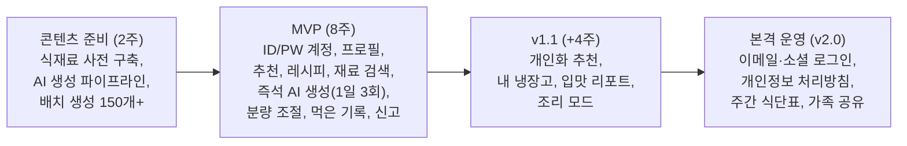

# PRD: 아기 유아식·간식 아이디어 웹앱 (가칭 「오늘 뭐 먹지, 아가?」)

| 항목 | 내용 |
|---|---|
| 문서 버전 | v0.3 |
| 작성일 | 2026-10-31 |
| 상태 | MVP 범위 확정 |
| 플랫폼 | 모바일 우선 반응형 웹앱 (PWA) |
| 지원 월령 | **12~48개월 유아식** |
| 수익 모델 | **완전 무료** (광고·구독 없음) |
| 콘텐츠 방식 | **AI가 웹(유튜브·구글 등) 검색 결과를 바탕으로 레시피 생성**, 사람 검수 없이 자동 검증만 거침 |
| 계정 | **ID/PW 회원가입만 사용** (개인정보 수집 없음) |

**변경 이력**
- v0.3: 즉석 AI 생성 인당 1일 3회 확정, 사람 검수 절차 제거, 지원 월령 12~48개월 확정, 개인정보 없는 ID/PW 회원가입으로 계정 정책 변경(3.10), 생년월일 → 월령 입력으로 변경, MVP에서 사진 기록 제외
- v0.2: 레시피 콘텐츠를 AI 웹 검색 기반 생성으로 확정, 수익 모델 무료 확정
- v0.1: 초안

---

## 1. 개요

### 1.1 배경 및 문제 정의
- 돌 이후 유아식으로 넘어가는 시기의 부모는 **매 끼니·간식 메뉴를 정하는 일**이 큰 부담이다.
- 일반 레시피는 성인 기준이라 **간(염분), 식감, 크기, 알레르기**를 다시 따져봐야 한다.
- 레시피 분량이 아기 1끼에 맞지 않아 **남거나 모자라고**, 소분 보관 계획을 세우기 어렵다.
- 아기가 **무엇을 잘 먹고 무엇을 거부했는지** 기억에 의존해 반복 실패가 생긴다.

### 1.2 제품 비전
> "냉장고 속 재료와 아기의 월령·입맛을 바탕으로, 1분 안에 오늘의 유아식·간식을 정해주는 육아 주방 비서"

### 1.3 목표
| 구분 | 목표 |
|---|---|
| 사용자 목표 | 메뉴 고민 시간 단축, 아기에게 안전한 음식 제공, 아기 입맛 파악 |
| 서비스 목표 | 주간 재방문 사용자 확보, 기록 데이터 기반 개인화로 리텐션 강화 |
| 운영 목표 | 무료 서비스 유지를 위해 **AI·API 호출 비용 최소화** (생성 레시피 캐싱·재사용, 1일 생성 한도) |

### 1.4 범위 외 (Non-Goals, MVP)
- 의료·영양 상담 (진단/처방 성격의 조언)
- 장보기 커머스 연동, 결제, 광고, 유료 구독
- 유튜브 영상·웹사이트 원문/이미지의 복제 게시 (출처 링크만 제공)
- **12개월 미만 이유식** 및 **48개월 초과** 식단
- 레시피 사람 검수 절차 (자동 검증 + 사용자 신고로 대체)
- 개인정보(이메일, 휴대폰, 실명, 생년월일 등) 수집, 소셜 로그인
- 사진 업로드, 사용자 레시피 업로드 커뮤니티

---

## 2. 타깃 사용자

### 2.1 주요 타깃
- 생후 **12~48개월** 아이를 키우는 부모·양육자 (조부모, 돌보미 포함)

### 2.2 페르소나
| 페르소나 | 특징 | 핵심 니즈 |
|---|---|---|
| **워킹맘 지은 (34)** | 15개월 아들, 퇴근 후 30분 내 요리 | 집에 있는 재료로 빨리 만들 메뉴 |
| **초보아빠 민수 (31)** | 20개월 딸, 요리 경험 적음 | 따라 하기 쉬운 단계별 레시피, 정확한 분량 |
| **꼼꼼맘 수현 (36)** | 26개월 딸, 달걀 알레르기 | 알레르기 제외, 저염 관리, 먹은 기록 |

---

## 3. 기능 요구사항

우선순위: **P0** = MVP 필수 / **P1** = MVP 포함 권장 / **P2** = 후속 버전

### 3.1 기능 맵

---

### 3.2 [P0] 아기 프로필

| ID | 요구사항 |
|---|---|
| PRF-01 | 아기 닉네임(선택, 실명 입력 비권장 안내) + **현재 월령(12~48개월) 선택** → 연령 단계 자동 지정. 생년월일은 수집하지 않음 |
| PRF-02 | 월령 자동 증가: 입력 시점의 월령과 입력일만 저장해 매달 자동으로 월령 갱신 (사용자 수동 수정 가능) |
| PRF-03 | 48개월 도달 시 "지원 월령 종료" 안내, 3단계 레시피는 계속 이용 가능 |
| PRF-04 | 간 단계 설정: **무염 / 저염 / 일반(유아 기준 싱겁게)** |
| PRF-05 | 알레르기·기피 식재료 등록 (주요 알레르기 유발 식품 체크리스트 + 직접 입력) |
| PRF-06 | 다자녀 대비 프로필 여러 개(최대 5개) 생성 및 전환 |

**연령 단계 정의**

| 단계 | 월령 | 식감 가이드 | 기본 간 단계 |
|---|---|---|---|
| 완료기 | 12~15개월 | 무른 밥, 잇몸으로 으깰 수 있는 정도 | 무염 |
| 유아식 1단계 | 16~24개월 | 진밥, 작게 썬 반찬 | 무염~저염 |
| 유아식 2단계 | 25~36개월 | 일반 밥에 가까움 | 저염 |
| 유아식 3단계 | 37~48개월 | 가족식 응용 | 저염 |

> 단계 구간·식감 기준은 공개된 공공기관 유아 식생활 가이드를 참고해 개발 착수 전 확정.

---

### 3.3 [P0] 메뉴 추천

| ID | 요구사항 |
|---|---|
| REC-01 | 홈 화면에 **오늘의 추천** 제공: 식사(아침/점심/저녁) + 간식 카테고리 |
| REC-02 | 추천은 프로필의 **월령 단계, 간 단계, 알레르기**를 자동 필터로 적용 (알레르기 식재료 포함 메뉴는 **절대 노출 금지**) |
| REC-03 | 필터: 식사/간식, 조리시간(10/20/30분+), 조리도구(전자레인지, 에어프라이어, 냄비 등), 주재료 분류(육류/생선/채소/곡류/달걀/유제품) |
| REC-04 | "다른 메뉴 보기"(새로고침) 및 즐겨찾기 |
| REC-05 | [P1] 먹은 기록 기반 개인화: 잘 먹은 메뉴와 유사 재료/조리법 가중치 ↑, 거부 메뉴 가중치 ↓ |
| REC-06 | [P1] 최근 3일 내 먹은 메뉴는 추천 순위 하향 (다양성 확보) |
| REC-07 | [P2] 주간 식단표 자동 생성 및 장보기 목록 출력 |

---

### 3.4 [P0] 재료 및 레시피 안내

| ID | 요구사항 |
|---|---|
| RCP-01 | 레시피 상세: 메뉴명, 대표 이미지, 적합 연령 단계, 간 단계, 조리시간, 난이도, 알레르기 유발 성분 태그 |
| RCP-02 | **재료 목록**: 재료명, 분량(g / 큰술 / 개 등), 대체 가능 재료 |
| RCP-03 | **단계별 조리법**: 단계별 설명, 단계별 타이머 버튼 |
| RCP-04 | **아기 맞춤 팁**: 식감 조절법, 크기(질식 위험 방지 썰기), 간 조절 포인트 |
| RCP-05 | 보관 정보: 냉장/냉동 보관 기간, 데우는 법 |
| RCP-06 | 연령별 변형 안내: 같은 메뉴의 단계별 차이(예: 완료기는 더 잘게, 무염 버전) |
| RCP-07 | [P1] 조리 모드: 화면 꺼짐 방지, 큰 글씨, 단계 넘기기 |

---

### 3.5 [P0] 집에 있는 재료 기반 추천

| ID | 요구사항 |
|---|---|
| ING-01 | 재료 입력: 자동완성 검색 + 자주 쓰는 재료 칩 선택 (예: 감자, 당근, 애호박, 두부, 소고기, 달걀) |
| ING-02 | 입력 재료 기준 매칭 결과를 **매칭률 순**으로 정렬 |
| ING-03 | 결과 카드에 "**모든 재료 보유**" / "**1~2개 부족: ○○, ○○**" 표시 |
| ING-04 | 기본 양념·상비 재료(물, 식용유, 참기름 등)는 "기본 보유"로 간주하는 옵션 |
| ING-05 | 프로필 필터(월령/간/알레르기) 동시 적용 |
| ING-06 | 매칭률 80% 이상 결과가 3개 미만이면 "**AI로 새 레시피 만들기 (오늘 남은 횟수 N/3)**" 버튼 노출 → 3.9 즉석 생성 |
| ING-07 | [P1] "내 냉장고" 저장: 입력한 재료 목록을 유지하고, 요리 완료 시 사용 재료 차감 선택 |
| ING-08 | [P2] 유통기한 임박 재료 우선 추천 |

**매칭 로직 (안)**
- 매칭 점수 = (보유한 필수 재료 수 ÷ 전체 필수 재료 수) × 100
- 동점 시: 개인화 점수(REC-05) → 조리시간 짧은 순
- 필수 재료와 선택 재료(고명 등)를 구분해 선택 재료는 점수 계산에서 제외

---

### 3.6 [P0] 연령대·무염/저염별 추천

| ID | 요구사항 |
|---|---|
| AGE-01 | 모든 레시피에 **적합 연령 단계(복수 가능)** 와 **간 단계** 메타데이터 부여 |
| AGE-02 | 프로필 기준 자동 필터 + 수동으로 다른 단계 탐색 가능 (단, 월령보다 높은 단계는 경고 문구 표시) |
| AGE-03 | 저염 레시피에는 **1회분 예상 나트륨(mg)** 표시 |
| AGE-04 | 무염 레시피는 소금·간장 등 대신 **맛 내기 대체법** 안내 (채수, 멸치·다시마 육수, 과일 단맛 등) |
| AGE-05 | 월령 기반 **금지/주의 식재료 경고** (예: 통견과류·통포도·떡 등 질식 위험 식품, 날음식, 카페인) |

> 참고: 한국인 영양소 섭취기준(2020) 나트륨 충분섭취량 1~2세 810mg/일, 3~5세 1,000mg/일. 최신 기준 확인 후 반영.

---

### 3.7 [P0] 분량 조절

| ID | 요구사항 |
|---|---|
| SRV-01 | 레시피 상세에서 **1~5회분** 선택 (스테퍼 또는 세그먼트 버튼), 기본값은 레시피 기준 분량 |
| SRV-02 | 회분 변경 시 **모든 재료 분량 실시간 재계산** |
| SRV-03 | 단위 처리 규칙: g/ml은 정수 반올림, 개수 단위는 ½·¼ 단위로 표시 (예: 달걀 1.5개 → "달걀 1½개"), 매우 적은 양은 "약간"으로 표기 |
| SRV-04 | 1회분 기준량을 연령 단계별로 다르게 정의 (예: 완료기 밥 80~100g, 2단계 100~120g) |
| SRV-05 | 2회분 이상 선택 시 **소분·냉동 보관 팁** 자동 노출 |
| SRV-06 | [P2] 조리시간 변화 안내 (분량이 많을 때 가열시간 증가 등) |

---

### 3.8 [P0] 먹은 기록 관리

| ID | 요구사항 |
|---|---|
| LOG-01 | 레시피 상세 또는 홈에서 "**먹었어요**" 기록 버튼 |
| LOG-02 | 반응 평가 3단계: 😋 **잘 먹었어요** / 😐 **보통이에요** / 🙅 **안 먹었어요** |
| LOG-03 | 추가 입력(선택): 먹은 양(다 먹음/절반/조금), 식사 시간대, 메모 (사진은 MVP 제외) |
| LOG-04 | **이상 반응 기록**: 발진, 구토, 설사 등 체크 → 해당 식재료를 알레르기 의심 목록에 추가할지 묻기 |
| LOG-05 | 기록 목록: 날짜별 캘린더 뷰 + 메뉴별 뷰 (메뉴별 누적 평가 표시) |
| LOG-06 | 메뉴 카드에 최근 평가 배지 표시 (예: "잘 먹음 3회") |
| LOG-07 | [P1] 입맛 리포트: 잘 먹은 TOP 메뉴/식재료, 거부 식재료, 아직 시도 안 한 식재료 추천 |
| LOG-08 | [P2] 가족 공유: 양육자 여러 명이 같은 아기 기록 공유 |

---

### 3.9 [P0] AI 레시피 생성 (웹 검색 기반)

모든 레시피는 AI가 유튜브·구글 등에서 검색한 자료를 참고해 **아기용으로 재구성**한 뒤, **사람 검수 없이 규칙 기반 자동 안전 검증만 통과하면 즉시 게시**된다.

| ID | 요구사항 |
|---|---|
| AI-01 | **검색**: 공식 API(YouTube Data API, Google 검색 그라운딩 등)로 메뉴/재료 관련 자료 수집. 크롤링·영상 다운로드 금지 |
| AI-02 | **출처 선별**: 유아식 전문 채널/사이트, 공공기관(식약처, 보건소 등) 자료 우선. 조회수·평점 등으로 신뢰도 점수 부여 |
| AI-03 | **구조화 생성**: AI는 정해진 JSON 스키마(재료·분량·단위·단계·연령 단계·간 단계·알레르기 성분·보관법·아기 맞춤 팁)로 출력 |
| AI-04 | **아기용 재작성**: 원문을 복제하지 않고 아기 기준으로 재구성 (소금·설탕 제거/감량, 식감·크기 조정, 1회분 기준 분량 환산) |
| AI-05 | **자동 안전 검증 (규칙 기반, AI와 별도) — 사람 검수를 대신하는 유일한 게이트**: ① 모든 재료가 식재료 사전에 매핑되는지 확인 (미등록 재료 포함 시 불통과) ② 알레르기 성분 태그와 재료 목록 교차 검증 ③ 월령별 금지·주의 식재료 차단 ④ 식재료 사전 기준 1회분 **나트륨 재계산**으로 간 단계 검증 ⑤ 필수 필드 누락·비정상 분량(1회분 총량 범위 초과 등) 차단 |
| AI-06 | **출처 표기**: 레시피 하단에 "참고한 자료" 링크(영상 제목·채널명/사이트명) 표시. 유튜브는 공식 임베드 플레이어 또는 링크만 사용 |
| AI-07 | **이미지**: 출처 이미지 복제 금지. AI 생성 이미지 또는 일러스트·기본 아이콘 사용 ("AI 생성 이미지" 표기) |
| AI-08 | **AI 생성 표시**: 모든 레시피에 "AI가 웹 자료를 참고해 만든 레시피입니다. 사람이 검수하지 않았으니 재료와 조리법을 꼭 확인하세요" 배지와 면책 문구 노출 |
| AI-09 | **생성 방식 (비용 절감)**: ① 출시 전 **배치 생성**으로 기본 레시피 풀 확보 ② 재료 기반 검색 결과가 부족할 때만 **즉석 생성** ③ 생성 결과는 DB에 캐싱해 다른 사용자에게 재사용 |
| AI-10 | **즉석 생성 한도: 계정당 1일 3회** (매일 00:00 KST 초기화). 남은 횟수 상시 표시, 소진 시 "내일 다시 이용 가능" 안내. 검증 실패로 폐기된 생성은 횟수 차감하지 않음. 캐시 적중(동일 조건 기존 레시피 반환)은 횟수 차감 없음 |
| AI-11 | **서비스 전체 일일 생성 상한**: 무료 티어 보호를 위해 전체 즉석 생성 상한 설정, 도달 시 기존 레시피만 제공 |
| AI-12 | **사용자 신고**: "레시피가 이상해요" 신고(분량 오류, 위험 재료, 맛 없음) → 신고 3건 누적 또는 "위험 재료" 신고 1건 시 **자동 비노출** 및 재생성 대기열 등록 |
| AI-13 | **품질 피드백 루프**: 먹은 기록 평점·신고 데이터를 레시피 품질 점수에 반영, 낮은 점수 레시피는 추천 순위 하향 |

---

### 3.10 [P0] 계정 (ID/PW, 개인정보 미수집)

| ID | 요구사항 |
|---|---|
| ACC-01 | **회원가입 필수**: 서비스 이용 전 ID/PW로 가입·로그인 (비로그인 체험 없음) |
| ACC-02 | **ID 규칙**: 영문 소문자·숫자 4~20자, 중복 불가. 이메일·휴대폰 번호 형식 입력 차단, "실명이나 연락처를 ID로 쓰지 마세요" 안내 |
| ACC-03 | **PW 규칙**: 8자 이상, 영문+숫자 조합. 서버에 단방향 해시(bcrypt/argon2)로만 저장 |
| ACC-04 | **복구 코드**: 연락처가 없어 비밀번호 찾기가 불가하므로, 가입 완료 시 **1회용 복구 코드**를 발급·표시 ("복사"·"이미지로 저장" 버튼). 복구 코드로 비밀번호 재설정 가능, 사용 시 새 코드 재발급 |
| ACC-05 | 가입 시 고지: "비밀번호와 복구 코드를 모두 잃어버리면 계정을 되찾을 수 없습니다" 동의 체크 |
| ACC-06 | 로그인 유지(자동 로그인) 옵션, 로그인 5회 연속 실패 시 일시 잠금(10분) |
| ACC-07 | 비밀번호 변경, 복구 코드 재발급, **회원 탈퇴 시 모든 데이터 즉시 삭제** |
| ACC-08 | 수집 항목은 ID, PW 해시, 서비스 이용 데이터(아기 닉네임·월령·알레르기·기록)로 한정. 실명·이메일·전화번호·생년월일 미수집 |
| ACC-09 | [P2, 본격 운영 시] 이메일 인증·소셜 로그인 도입, 개인정보 처리방침 정비, 기존 ID 계정 연동 |

---

## 4. 주요 사용자 플로우

### 4.1 재료 기반 추천 → 요리 → 기록

### 4.2 가입 및 온보딩
1. 앱 소개 (3장 이내)
2. ID/PW 입력 → 가입
3. **복구 코드 표시** → 저장 확인 체크 후 다음
4. 아기 닉네임(선택)·현재 월령 선택 → 연령 단계 자동 표시
5. 간 단계 선택 (월령 기반 기본값 제안)
6. 알레르기·기피 재료 선택 (건너뛰기 가능)
7. 홈 진입 → 오늘의 추천

---

## 5. 화면 구성 (IA)

| 탭 | 주요 화면 |
|---|---|
| 🏠 홈 | 오늘의 추천(식사/간식), 프로필 전환, 최근 잘 먹은 메뉴 |
| 🥕 재료로 찾기 | 재료 입력, 내 냉장고, 매칭 결과, AI로 만들기(남은 횟수 표시) |
| 📖 레시피 | 전체 탐색, 필터, 즐겨찾기 |
| 📝 기록 | 캘린더, 메뉴별 기록, 입맛 리포트 |
| 👶 마이 | 아기 프로필, 알레르기, 비밀번호 변경, 복구 코드 재발급, 로그아웃, 탈퇴 |
| (가입 전) | 로그인, 회원가입, 복구 코드로 비밀번호 재설정 |

---

## 6. 데이터 모델 (초안)

---

## 7. 비기능 요구사항

| 구분 | 요구사항 |
|---|---|
| **안전** | 알레르기 필터는 서버·클라이언트 이중 검증. 사람 검수가 없으므로 자동 안전 검증(AI-05) 불통과 레시피는 어떤 경우에도 노출 금지 |
| **면책** | "본 서비스는 의료적 조언을 대체하지 않습니다", "AI 생성 레시피는 사람이 검수하지 않았으며 부정확할 수 있습니다" 고지, 새 식재료는 소량부터 시도 안내 |
| 저작권 | 출처 원문·이미지 복제 금지, 출처 링크 표기, 각 API 이용약관 준수 |
| 비용 | 무료 티어 우선 사용, 생성 결과 캐싱, 계정당 1일 3회 + 서비스 전체 일일 상한 |
| 보안 | HTTPS 필수, PW·복구 코드 해시 저장, 로그인 실패 잠금, 가입 API 속도 제한(봇 대량 가입 방지, 필요 시 CAPTCHA) |
| 개인정보 | 개인정보 미수집 원칙(ACC-08). 접속 로그는 보안 목적 최소 기간만 보관. 탈퇴 시 즉시 삭제 |
| 성능 | 추천/검색 결과 응답 1초 이내, 즉석 AI 생성 20초 이내(진행 상태 표시), 모바일 LCP 2.5초 이내 |
| 사용성 | 한 손 조작 가능한 모바일 UI, 조리 모드 큰 글씨, 접근성(WCAG 2.1 AA) |
| 오프라인 | PWA로 즐겨찾기 레시피 오프라인 열람 |

---

## 8. 콘텐츠 요구사항

- **콘텐츠 출처**: AI가 유튜브·구글 등 웹 검색 결과를 참고해 생성 (3.9 참고), **사람 검수 없음**
- MVP 출시 전 **배치 생성으로 레시피 최소 150개** 확보 (식사 100 / 간식 50)
- 4개 연령 단계(12~48개월)에 고르게 분포, 무염 버전 레시피 비율 40% 이상
- 레시피당 메타데이터 필수: 연령 단계, 간 단계, 알레르기 성분, 조리시간, 기준 분량, 보관 정보, **출처 링크(1개 이상)**
- **식재료 사전 약 200종**은 공공 데이터를 바탕으로 구축 (자동 안전 검증의 기준 데이터)
  - 필드: 동의어(예 "애호박 = 호박", "소고기 = 쇠고기"), 알레르기 분류, 최소 섭취 월령, 100g당 나트륨
  - 나트륨 값은 식약처 식품영양성분 DB, 알레르기 분류는 식약처 알레르기 유발물질 표시 대상 기준 활용

---

## 9. 성공 지표 (KPI)

| 지표 | 목표 (출시 3개월) |
|---|---|
| 가입 → 온보딩 완료율 | 70% 이상 |
| 주간 활성 사용자(WAU) 재방문율 | 40% 이상 |
| 추천 → 레시피 상세 진입률 | 50% 이상 |
| 레시피 조회 대비 "먹었어요" 기록률 | 25% 이상 |
| 재료 기반 검색 사용률 | 활성 사용자의 30% 이상 |
| 레시피 신고율 | 레시피 조회 대비 1% 미만 |
| 자동 안전 검증 통과율 | 80% 이상 (낮으면 프롬프트 개선) |
| 즉석 AI 생성 캐시 적중률 | 70% 이상 (비용 통제) |

---

## 10. 릴리즈 로드맵

### 기술 스택 제안 (참고, 무료 티어 중심)
- 프론트엔드: Next.js (React) + TypeScript, PWA
- 백엔드/DB: Supabase (PostgreSQL) 또는 Firebase
  - 참고: 두 서비스의 기본 인증은 이메일 기반이므로, ID/PW 방식은 **자체 인증 구현** 또는 `ID@내부도메인` 형태의 가상 이메일 매핑으로 처리
- AI: Gemini API (Google 검색 그라운딩 + 구조화 JSON 출력), 이미지 생성 모델 (선택)
- 검색: YouTube Data API v3 (일일 할당량 내 사용)
- 호스팅: Vercel

---

## 11. 리스크 및 대응

| 리스크 | 영향 | 대응 |
|---|---|---|
| 알레르기 필터 누락으로 인한 안전 사고 | 매우 높음 | 식재료 단위 태깅 + 가공식품(예: 빵 속 달걀) 하위 성분 태깅, 규칙 기반 교차 검증 |
| **AI 환각 + 사람 검수 부재** (잘못된 분량·조리법, 위험 재료) | 매우 높음 | 자동 안전 검증을 엄격하게(미등록 재료 즉시 불통과), 강한 면책 문구, 위험 신고 1건 즉시 비노출, 검증 통과율·신고율 모니터링 |
| **저작권·약관 위반** (유튜브·웹 콘텐츠 활용) | 높음 | 공식 API만 사용, 원문·이미지 복제 금지, 재구성 + 출처 링크 표기 |
| **무료 운영 비용 증가** (AI·API 호출) | 높음 | 배치 생성 + 캐싱, 계정당 1일 3회, 서비스 전체 상한, 무료 티어 모니터링·알림 |
| **다중 계정으로 생성 한도 우회** | 중간 | 가입 속도 제한·CAPTCHA, 서비스 전체 일일 상한 |
| **계정 분실** (비밀번호 찾기 불가) | 중간 | 복구 코드 발급·저장 유도, 가입 시 고지·동의 |
| 웹 출처 품질 편차 (성인용·고염 레시피) | 중간 | 유아식 전문 출처 우선, 신뢰도 점수, 아기용 재작성 규칙, 나트륨 재계산 |
| 기록 기능 이탈 (귀찮음) | 중간 | 원탭 기록 |
| 분량 환산 시 어색한 수치 | 낮음 | 단위별 반올림 규칙(SRV-03) |

---

## 12. 의사결정 기록

| 항목 | 결정 | 버전 |
|---|---|---|
| 레시피 콘텐츠 출처 | AI가 유튜브·구글 등 웹 검색 자료를 참고해 생성 | v0.2 |
| AI 활용 범위 | 배치 생성 + 재료 검색 결과 부족 시 즉석 생성 | v0.2 |
| 수익 모델 | 완전 무료 | v0.2 |
| 즉석 AI 생성 한도 | 계정당 1일 3회 | v0.3 |
| 레시피 검수 | 사람 확인 절차 없음, 자동 안전 검증 + 사용자 신고만 운영 | v0.3 |
| 지원 월령 | 12~48개월 유아식 | v0.3 |
| 계정 | 개인정보 없는 ID/PW 회원가입, 본격 운영 시 개선 | v0.3 |

### 남은 확인 사항 (개발 중 결정 가능)
- 연령 단계 구간·1회분 기준량 최종 수치 (공공 가이드 참고)
- 서비스 전체 일일 생성 상한 값 (선택한 AI API 무료 티어 기준으로 산정)
