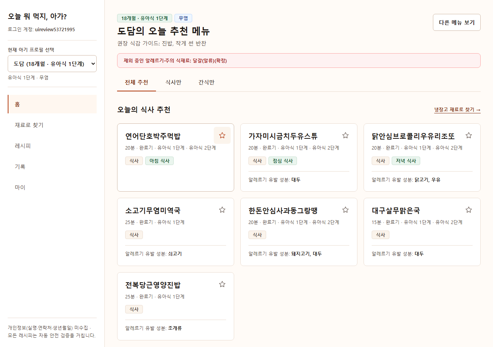

# UI·UX 개선 결과

- 기준: [UI-AI-티-개선-검토서](./UI-AI-티-개선-검토서.md)
- 작업일: 2026-10-31
- 범위: 검토서 P0~P2, 공용 컴포넌트 및 인증·홈·재료·레시피·상세·조리 모드·기록·마이·오프라인 화면
- 원본 검토서는 수정하지 않았습니다.

## 1. 기본 뼈대

- 반경을 배지 4px, 버튼·입력·선택 칩 6px, 카드·모달 8px로 구분했습니다.
- 페이지의 큰 헤더 카드를 평면적인 제목 영역으로 변경하고, 상세 화면은 구분선 중심의 섹션으로 정리했습니다.
- UI 색상을 공통 CSS 변수로 통일했습니다. 일반 카드의 그림자는 제거했습니다.
- 포커스 시 요소 자체의 반경을 바꾸던 규칙을 제거했습니다.
- 아바타 등의 예외를 포함해도 현재 화면 소스에 `rounded-xl`, `rounded-2xl`, `rounded-3xl`, `rounded-full`은 남아 있지 않습니다.

## 2. 기능 구현

- **레시피 카드:** 제목 → 조리시간·연령 → 최대 두 개의 배지 순으로 정리했습니다. 반복되는 AI·무염 배지와 목록 요약, 추가 추천 문구는 제거했습니다. 프로필과 다른 간 단계는 메타 정보로 표시합니다.
- **즐겨찾기:** 우상단 44px 아이콘 버튼으로 바꾸고 접근 가능한 이름, 선택 상태, 오프라인 동기화를 유지했습니다. 변경 실패 시 피드백을 제공합니다.
- **내비게이션:** 데스크톱은 텍스트와 활성 표시선, 모바일은 단색 SVG 아이콘과 짧은 라벨을 사용합니다.
- **필터:** 분류·조리시간을 우선 노출하고 연령·간 단계·도구·주재료는 필터 더보기에 넣었습니다. 접어도 적용된 필터 개수를 표시합니다.
- **재료:** 선택 칩과 AI 생성 안내를 단순화했습니다. 냉장고 저장 성공·실패 결과를 저장 버튼 근처에 지속적으로 표시합니다.
- **상세:** 개발용 일러스트 설명 박스를 제거하고 난이도를 쉬움·보통·어려움으로 표시합니다. 예시 출처의 시드 문구는 정리하되, 링크와 참고용 예시라는 설명은 보존합니다.
- **기록·프로필:** 캘린더를 직각 격자로 바꾸고 기록 건수에서 해당 날짜 기록으로 이동할 수 있게 했습니다. 알레르기 입력은 일반 체크박스 목록으로 정리했습니다.
- **문구·추천:** 받침에 맞는 조사를 적용하고, 안전 필터를 통과한 홈 추천에서 이름이 같은 메뉴가 반복되지 않도록 했습니다. 기존 요약의 표시는 교정하지만 저장된 레시피 원문은 변경하지 않습니다.
- **상태 화면:** 토스트·빈 상태·복구 코드·오프라인 안내의 장식 이모지를 정리했습니다.

## 3. UI·접근성

안전·법적 고지는 유지했습니다.

- 상세 화면의 AI 생성·사람 미검수 안내 및 의료 고지
- 알레르기 유발 성분과 월령 초과 경고
- 알레르기 필터, 신고, 이상 반응 등록과 오프라인 보관함 정화
- 주요 버튼·입력의 최소 44px 높이 및 키보드 포커스

직접 브라우저에서 재측정한 결과입니다. 목록 개수는 개발용 테스트 계정의 현재 프로필과 데이터에 따라 달라집니다.

| 화면 | 표시 카드 | 이모지 | 카드당 배지 | 사용 반경 | 가로 넘침 |
|---|---:|---:|---|---|---|
| 전체 레시피 | 147 | 0 | 1개 | 4·6·8px | 없음 |
| 감자·당근·두부 추천 | 40 | 0 | 2개 | 4·6·8px | 없음 |

데스크톱 브라우저의 실제 CSS 화면 폭 2133px에서 측정했습니다. 자동화 검증은 별도로 320·360·390·768·1280px에서 수행했습니다.

## 4. 요구사항·버그·엣지케이스 검토

| 검증 | 결과 |
|---|---|
| ESLint | 통과 |
| TypeScript | 통과 |
| 프로덕션 빌드 | 통과 |
| 단위·통합 테스트 | **55/55 통과** |
| Chromium E2E | **11/11 통과**, 건너뛰기·불안정 테스트 없음 |
| axe 접근성 | 인증·온보딩·주요 화면·조리 모드의 critical/serious 위반 0건 |
| 반응형 | 320px 및 글자 200%에서 가로 넘침 없음, 360·390·768·1280px 화면 확인 |
| 기존 기능 | 가입·복구 코드·프로필·알레르기 차단·검색·즐겨찾기·분량·기록·조리 모드·오프라인 보관함 확인 |

검증 중 발견해 수정한 항목:

- 모바일 재료 메뉴의 보이는 라벨과 접근 가능한 이름 불일치
- 로딩 중 고정 폭 스켈레톤의 작은 화면 가로 넘침
- 서비스워커가 개발용 JS·CSS를 재사용하여 이전 UI를 표시하는 문제: 개발 중 앱 워커를 해제하고 정적 번들 캐시를 정리합니다. 즐겨찾기 데이터는 보존합니다.
- 별도 포트의 로컬 Prisma 개발 DB도 단일 연결 설정을 적용하도록 포트 번호 의존성을 제거했습니다.

자동화 검증은 기존 DB와 분리한 로컬 테스트 DB(54339)와 임시 프로덕션 서버(3108)에서 수행했습니다. AI 생성 E2E는 모의 응답을 사용했으며, 외부 Gemini·YouTube 실호출이나 실제 배포는 수행하지 않았습니다.

병행 수정된 `GEMINI_MODEL` 설정 및 `getModelName()` 지원을 복원·보존한 상태에서 최종 검증했습니다.

## 화면

- [데스크톱 홈](./ui-review/home-desktop.png)
- [모바일 홈](./ui-review/home-mobile.png)
- [모바일 상세 및 AI 안전 고지](./ui-review/recipe-detail-mobile.png)
- [브라우저 측정 결과](./ui-review/measurements.json)

